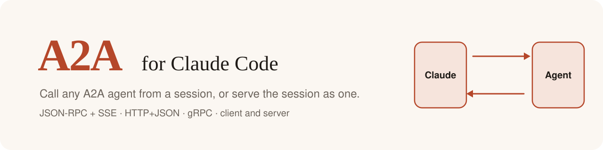

# a2a: Agent2Agent for Claude Code

<p align="center"></p>

<p align="center">
  <a href="https://github.com/fulgas/claude-a2a/releases/latest"></a>
  <a href="https://fulgas.github.io/claude-a2a/"></a>
  <a href="#license"></a>
  <a href="https://github.com/fulgas/claude-a2a/actions/workflows/codeql.yml"></a>
  <a href="https://scorecard.dev/viewer/?uri=github.com/fulgas/claude-a2a"></a>
</p>

Documentation: **[fulgas.github.io/claude-a2a](https://fulgas.github.io/claude-a2a/)**

A Claude Code plugin that speaks the [A2A protocol](https://a2a-protocol.org) in both directions:

- **Client.** Claude gets tools to call remote A2A agents over JSON-RPC (HTTP + SSE streaming), HTTP+JSON or gRPC.
- **Server.** `/a2a-serve` exposes your running session as an A2A agent on all three transports. Each incoming task runs as a subagent in that session, and its answer goes back as the task's artifact.

## Install

```
/plugin marketplace add fulgas/claude-a2a
/plugin install a2a@claude-a2a
```

Or, while developing: `claude --plugin-dir /path/to/claude-a2a`.

Requires Node 20+ on `PATH`. The bridge ships prebuilt in `dist/`, so there is no `npm install` step.

## Client tools

| Tool | Does |
| --- | --- |
| `mcp__a2a__card` | Fetches an agent card from a base URL |
| `mcp__a2a__send` | Sends a message and streams progress until the task settles. `contextId` continues a conversation, `taskId` answers an `input-required` task |
| `mcp__a2a__get_task` | Returns a task's state and artifacts |
| `mcp__a2a__cancel_task` | Cancels a task |

Every tool takes `transport` (`jsonrpc` \| `rest` \| `grpc`; the default is the agent card's preference) and `token` (bearer; the default is `$A2A_TOKEN`).

## Server

```
/a2a-serve [--port 41241] [--grpc-port 41242] [--transports all|http|grpc] [--host 127.0.0.1] [--token T] [--name N]
/a2a-stop
```

| Transport | Endpoint |
| --- | --- |
| Agent card | `http://HOST:PORT/.well-known/agent-card.json` |
| JSON-RPC + SSE | `http://HOST:PORT/a2a/jsonrpc` |
| HTTP+JSON | `http://HOST:PORT/a2a/rest` |
| gRPC | `HOST:GRPC_PORT` (plaintext) |

### Saved settings

Set defaults in `/plugin`, under the plugin's options, or in `settings.json`:

```json
{
  "pluginConfigs": {
    "a2a@claude-a2a": {
      "options": { "port": 9300, "grpcPort": 9301, "host": "127.0.0.1", "name": "My Claude", "autoServe": true }
    }
  }
}
```

| Option | Default | |
| --- | --- | --- |
| `port` | `41241` | HTTP port (card, JSON-RPC + SSE, HTTP+JSON) |
| `grpcPort` | `41242` | gRPC port |
| `transports` | `all` | `all`, `http` (JSON-RPC + HTTP+JSON) or `grpc`. In `grpc` mode the HTTP port serves only the agent card, which clients need to find the gRPC endpoint |
| `host` | `127.0.0.1` | Bind address. Anything else requires `token` |
| `name` | `Claude Code` | Agent name in the card |
| `token` | empty | Bearer token callers must send. Marked sensitive, so set it in `/plugin`, which keeps it in secure storage |
| `autoServe` | `false` | Start the server when a session starts |

Flags typed after `/a2a-serve` override the saved values for that run. The bridge receives the token through its environment (`A2A_SERVE_TOKEN`), never on the command line. On the client side, `A2A_TOKEN` is the default bearer token for outgoing calls.

**Security.** Incoming tasks run with this session's tools and permissions. The server binds to `127.0.0.1` by default. It refuses any other host unless you pass `--token`, and then every call must send `Authorization: Bearer <token>` (gRPC: `authorization` metadata). gRPC has no TLS, so put a TLS proxy in front of it before exposing it beyond your machine.

## How it works

The plugin's hooks module can't open sockets, so a Node bridge (`dist/a2a.mjs`, built on [`@a2a-js/sdk`](https://github.com/a2aproject/a2a-js)) speaks the wire protocols. Each incoming task runs as a subagent in your session. [docs/architecture.md](docs/architecture.md) has the full picture: arc42 sections, C4 diagrams and sequence diagrams.

## Contributing

See [CONTRIBUTING.md](CONTRIBUTING.md). Report vulnerabilities privately, as [SECURITY.md](SECURITY.md) says.

## License

Licensed under either of [Apache License, Version 2.0](LICENSE-APACHE) or [MIT license](LICENSE-MIT), at your option.
