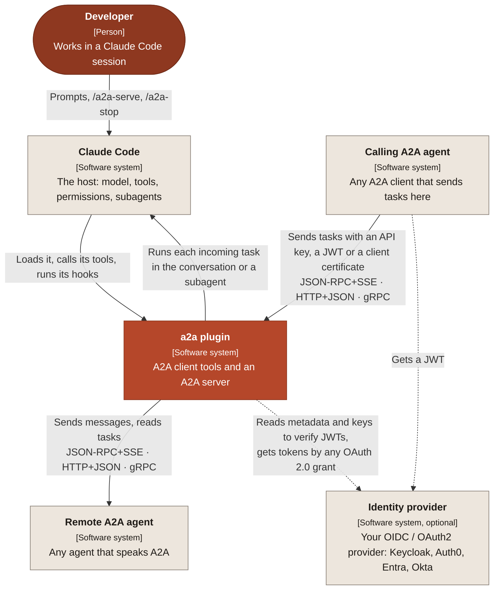
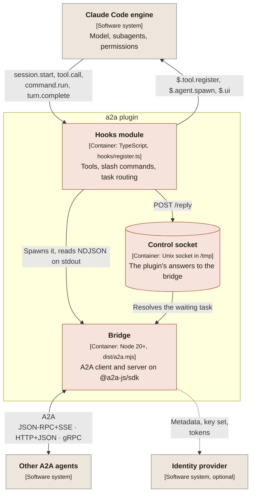
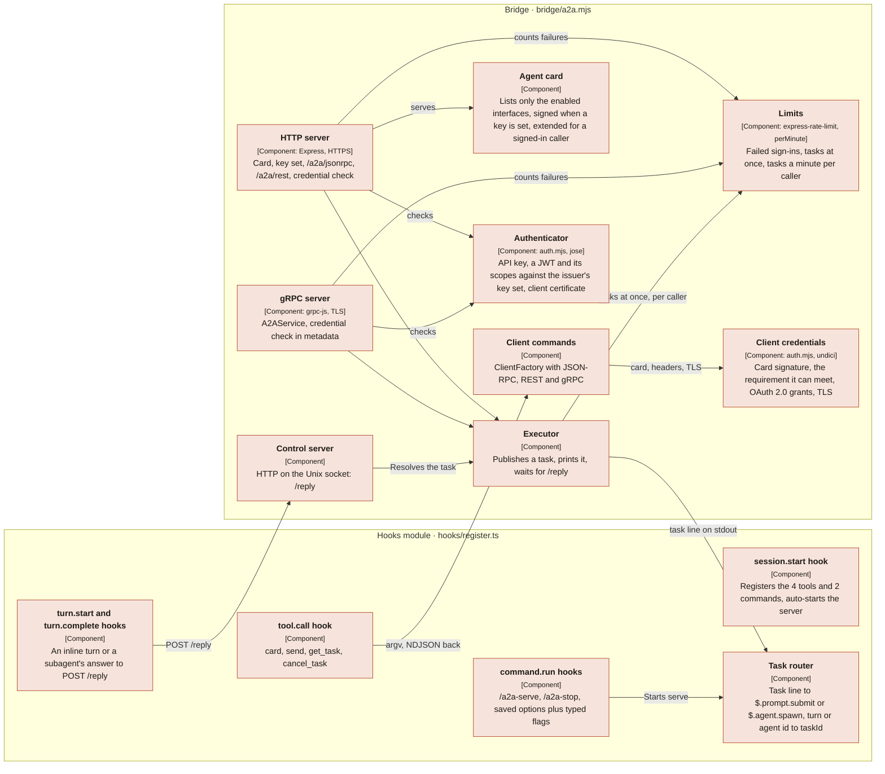
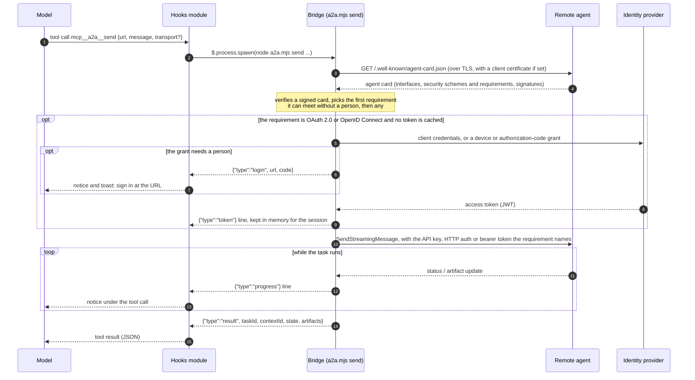
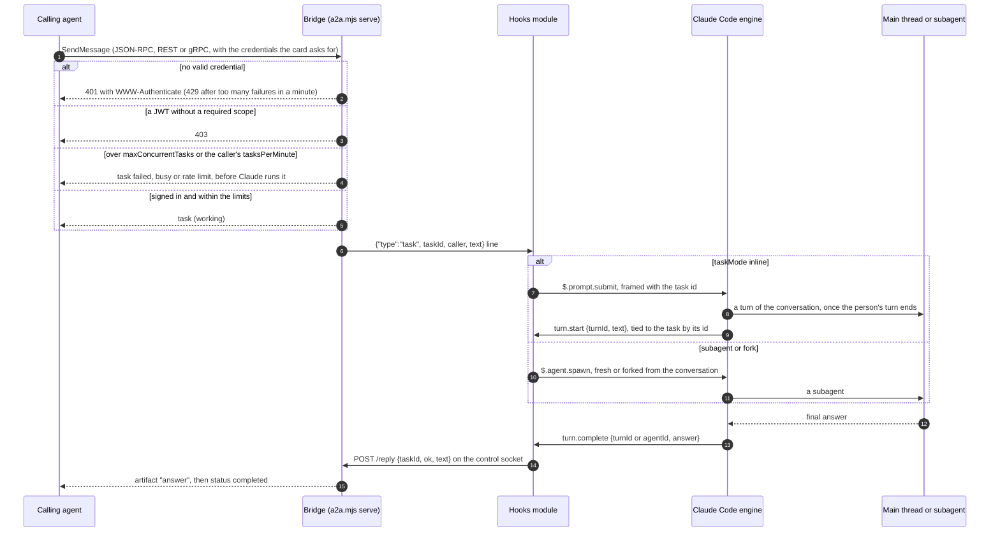
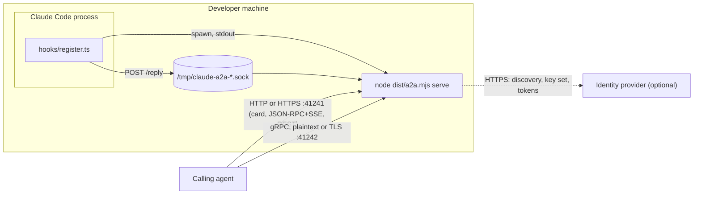

# Architecture

This document follows [arc42](https://arc42.org). Diagrams follow the [C4 model](https://c4model.com): each box names the element, its kind in brackets and what it does. They are written in Mermaid, so GitHub renders them in place.

## 1. Introduction and goals

`a2a` is a Claude Code plugin that speaks the [Agent2Agent (A2A) protocol](https://a2a-protocol.org) in both directions:

- **Client:** Claude calls remote A2A agents through four tools.
- **Server:** a running Claude Code session becomes an A2A agent. Each incoming task runs in that session: by default as a prompt in the conversation, or in a subagent with a fresh context or a copy of the conversation.

| Goal | What it means here |
| --- | --- |
| Every A2A transport | JSON-RPC over HTTP with SSE streaming, HTTP+JSON (REST), and gRPC, on both sides |
| Installs with one command | `/plugin install`, with no build step and no package install on the user's machine |
| Safe by default | The server listens on loopback only unless an API key, an OIDC / OAuth 2.0 issuer or a client CA is set |
| The specification's security | Every security scheme of the A2A specification, on both sides where it applies: API key, HTTP auth, OAuth 2.0, OpenID Connect and mutual TLS; TLS; signed agent cards; the extended agent card |

## 2. Constraints

| Constraint | Consequence |
| --- | --- |
| A Claude Code hooks module has no Node, no sockets and no DOM. It reaches the outside only through `$`. | The wire protocols live in a separate Node process: the bridge. |
| `$.http.fetch` resolves only after the whole body is read. | It cannot read an SSE stream or speak gRPC, which is one more reason for the bridge. |
| `$.process.spawn` closes the child's stdin after the first write. | The plugin answers the bridge over a Unix socket (`$.http.fetch` with `socketPath`), not over stdin. |
| Plugins install by copying the repository, with no `npm install`. | The bridge is bundled into one committed file, `dist/a2a.mjs`, and CI checks that it matches the source. |
| A2A clients find an agent by fetching its card over HTTP. | The HTTP port always serves the agent card, even in `grpc`-only mode. |

## 3. Context and scope

| Neighbour | Exchanges |
| --- | --- |
| Developer | Asks Claude to talk to an agent; starts and stops the server; sets the plugin's options |
| Claude Code | Loads the plugin, offers its tools to the model, runs subagents, enforces permissions |
| Remote A2A agent | Agent card, messages, tasks, artifacts |
| Calling A2A agent | The same, in the other direction, with an API key, a JWT or a client certificate when the server asks for one |
| Identity provider | Optional. Its metadata and key set, which the server verifies JWTs against; tokens for the client, by the client-credentials, device-code or authorization-code grant. The plugin never issues tokens |

## 4. Solution strategy

- **Split by capability.** The hooks module does what only it can do: register tools and commands, spawn subagents, and read their answers. The bridge does what only Node can do: sockets, HTTP/2, SSE and gRPC.
- **Use the official SDK.** The bridge is a thin layer over [`@a2a-js/sdk`](https://github.com/a2aproject/a2a-js). The protocol logic stays upstream.
- **NDJSON between the two.** The bridge writes one JSON object per line on stdout. The plugin reads them as they arrive.
- **The session as the server's brain.** An incoming task becomes a prompt in the conversation (`$.prompt.submit`), or a subagent (`$.agent.spawn`, a fork for `fork`), as `taskMode` says. The `turn.complete` answer of that turn or subagent becomes the task's artifact.

## 5. Building block view

### Level 2: containers

### Level 3: components

| Building block | Source |
| --- | --- |
| Hooks module | `hooks/register.ts` |
| Bridge | `bridge/a2a.mjs`, bundled to `dist/a2a.mjs` |
| Authentication, card signatures and limits | `bridge/auth.mjs` |
| Plugin manifest and options | `.claude-plugin/plugin.json` |
| Marketplace entry | `.claude-plugin/marketplace.json` |

## 6. Runtime view

### Calling another agent

### Receiving a task

### Starting the server

`/a2a-serve` merges the saved options with the typed flags (typed flags win) and spawns `a2a.mjs serve`. The API key travels in the environment as `A2A_SERVE_API_KEY`. With an issuer, the bridge first reads its OpenID Connect discovery document, or else its OAuth 2.0 metadata (RFC 8414), checks its `issuer`, and from then on fetches the key set as tokens need it. An issuer that cannot be reached stops the start with an error. With a signing key, it signs the card. It then binds the HTTP port and, unless `transports` is `http`, the gRPC port, then prints `{"type":"ready"}` with the endpoints. The plugin shows them in the status line. `/a2a-stop`, or the end of the session, ends the spawn loop, which kills the bridge.

## 7. Deployment view

- One bridge process per session that runs `/a2a-serve`. Client calls start a short-lived bridge each.
- Defaults: HTTP on `41241`, gRPC on `41242`, bound to `127.0.0.1`.
- The plugin itself installs from the `fulgas/claude-a2a` marketplace. The release is the git tag, and its files are the repository's contents at that tag.

## 8. Cross-cutting concepts

**Security.**
- An incoming message becomes a prompt that runs with the session's tools and permissions. The server is therefore loopback-only unless an API key, an issuer or a client CA is set; the bridge refuses any other host without one.
- **API key:** `X-API-Key` on HTTP, `x-api-key` metadata on gRPC, compared in constant time.
- **JWT from an OpenID Connect or OAuth 2.0 issuer:** `Authorization: Bearer <jwt>`. The bridge reads the issuer's discovery document, or else its RFC 8414 metadata, at start (its `issuer` must match exactly) and verifies each token against the issuer's key set with `jose`: signature with asymmetric algorithms only (so an HMAC token signed with a public key cannot pass), `iss`, `aud` (required) and `exp`, with 30 seconds of clock tolerance, and every scope in `requiredScopes` (from `scope` or `scp`). The token's `sub` becomes the caller's name, which the SDK carries to the task and the plugin shows. An OpenID Connect issuer is advertised as an `openIdConnect` scheme; a plain OAuth 2.0 one as one `oauth2` scheme per grant it offers (client credentials, device code, authorization code with PKCE), each with its `oauth2MetadataUrl`, since a scheme holds one flow.
- **TLS and mutual TLS:** with `tlsCert` and `tlsKey` both ports serve TLS, and the card names `https` endpoints. With `tlsClientCa` the TLS layer refuses any connection without a client certificate that CA signed; the card then lists `mtls` in every requirement, as it holds for all of them, and a certificate alone names the caller (`mtls:<CN>`) when no other scheme is on.
- **Refusals** follow the bindings: 401 with `WWW-Authenticate` challenges (RFC 6750 for the bearer token, with `error="invalid_token"` when one failed) and gRPC `UNAUTHENTICATED`; a token without a required scope gets 403 and `PERMISSION_DENIED`.
- **Signed agent card:** with `cardSigningKey` the card carries a JWS over its JCS canonical form (the SDK's `generateAgentCardSignature`), with the key's thumbprint as `kid` and `jku` pointing at `/.well-known/jwks.json` on the same port.
- **Extended agent card:** with any credential on, the card says it has one, and a signed-in caller gets it with the limits it will meet.
- **Limits.** A client that fails to sign in `authFailuresPerMinute` times (default 20) is refused for the rest of the minute: `express-rate-limit` on HTTP, a counter per peer on gRPC. Signed-in callers are capped too, since each task runs a subagent on the session's tokens: `maxConcurrentTasks` at once (default 4) and `tasksPerMinute` per caller (default 30). A task over a limit fails before any subagent starts.
- With an API key and an issuer both on, either credential passes, and the card lists each as a requirement of its own. The card itself stays public: it is how a client learns what to send.
- **The client** follows the card's security requirements: any one of them, every scheme within it, preferring one met without a person. It sends nothing to an agent whose card asks for nothing, so a token never reaches an agent that did not ask. It meets an API key in a header, cookie or query parameter; HTTP Bearer or Basic; OAuth 2.0 by a given token, client credentials, the device-code flow (RFC 8628) or the authorization-code flow with PKCE (RFC 7636) on a loopback redirect (RFC 8252), finding endpoints in the flow, its `oauth2MetadataUrl` or OpenID Connect discovery, and asking for the requirement's scopes; and mutual TLS with a client certificate. Implicit and password flows are deprecated by the specification and not supported.
- **Tokens** the bridge gets are reported to the hooks module, which keeps them in memory for the session and passes them back in the environment, so a person signs in once. A cached token is refreshed with its refresh token when it expires.
- **Card signatures** are checked before anything else is sent: against `trustedCardKeys`, or against the key set the signature's `jku` names, which must be on the agent's own origin and over HTTPS unless loopback. With `requireSignedCards`, an unsigned card is refused.
- Secrets (`A2A_SERVE_API_KEY`, the client's API key, Basic password and OAuth secret, and cached tokens) reach the bridge through the environment, never argv, so `ps` does not show them.
- gRPC over TLS sends the host as the TLS server name, which Node refuses to be an IP address: serve gRPC over TLS on a DNS name, as a certificate normally names one.
- **Where tasks run** (`taskMode`): `inline` (default) submits the task to the conversation, `fork` starts a subagent with a copy of it, `subagent` one with a fresh context. With `inline` or `fork` a caller's prompt runs with everything the conversation holds and can ask for it back, so those modes hand the conversation to whoever may send tasks; `subagent` keeps it from them. The bridge already refuses a non-loopback host without a credential.
- Claude Code's own permission prompts still apply to what the task does.

**Supply chain.** What runs on a user's machine is the hooks module and `dist/a2a.mjs`, which bundles the bridge's dependencies, so those are guarded hardest.
- CI rebuilds `dist/a2a.mjs` from the source and the lockfile and fails if it differs, so the committed bundle cannot carry code the source does not.
- `npm audit` gates known vulnerabilities in the bundled dependencies, and dependency review refuses a pull request that adds a vulnerable or GPL-licensed one. `npm audit signatures` checks every package against the registry's signatures and provenance.
- Every GitHub Action is pinned to a commit SHA; zizmor audits the workflows, and every workflow token has only the permissions its job needs. CodeQL analyses the code and the workflows; OpenSSF Scorecard rates the whole repository.
- The Zola binary that builds the docs site is checked against its SHA-256 before it runs.
- Each release rebuilds `dist/a2a.mjs` from its tag, checks it against the committed bundle, and signs SLSA build provenance for `dist/a2a.mjs`, `hooks/register.ts` and `plugin.json`. The immutable release carries GitHub's own release attestation. [SECURITY.md](https://github.com/fulgas/claude-a2a/blob/main/SECURITY.md#verifying-a-release) says how to verify both.
- Commits and tags are signed, `main` changes only through reviewed pull requests, and releases are immutable. Pull requests are merged with a merge commit, so the signed commits reach `main` as they were signed. Secret scanning with push protection refuses a pushed credential.

**Configuration.** The plugin's `userConfig` (the server's `port`, `grpcPort`, `transports`, `host`, `name`, `taskMode`, `apiKey`, `oidcIssuer`, `oidcAudience`, `requiredScopes`, `tlsCert`, `tlsKey`, `tlsClientCa`, `cardSigningKey`, `maxConcurrentTasks`, `tasksPerMinute`, `authFailuresPerMinute` and `autoServe`; the client's `clientApiKey`, `oauthClientId`, `oauthClientSecret`, `oauthScope`, `oauthAudience`, `oauthRedirectPort`, `clientUsername`, `clientPassword`, `clientTlsCa`, `clientTlsCert`, `clientTlsKey`, `trustedCardKeys` and `requireSignedCards`) lives in `pluginConfigs` in settings. The API keys, the Basic password and the OAuth secret are marked sensitive, so `/plugin` keeps them in secure storage. Keys and certificates are named by file path, never stored in settings. Flags typed after `/a2a-serve` override saved values for that run. Unset client options fall back to `A2A_API_KEY`, `A2A_TOKEN`, `A2A_HTTP_*`, `A2A_OAUTH_*`, `A2A_TLS_*` and `A2A_CARD_JWKS` in the environment.

**Errors.** Every bridge failure becomes a `{"type":"error"}` line. The plugin turns it into a tool error the model can read. A turn or subagent that ends without an answer fails its A2A task with the reason.

**Versioning.** One version for the plugin, `package.json` and the agent card. release-please keeps them in step from Conventional Commits.

## 9. Architecture decisions

| Decision | Why | Rejected |
| --- | --- | --- |
| A hooks-module plugin, not an MCP server | Native to Claude Code: tools, commands, subagents and the status line from one module | An MCP server: no subagents, no slash commands |
| A Node bridge on `@a2a-js/sdk` | Official SDK with all three transports, client and server; Node is already a Claude Code requirement | Python `a2a-sdk`: another runtime to install |
| Commit the bundled `dist/a2a.mjs` | Plugins install with no `npm install` | Install dependencies on first run: slow and fragile offline |
| Unix control socket for answers | `$.process.spawn` stdin is one-shot; `$.http.fetch` can use a socket path | A TCP port: reachable by other local users |
| Inline by default, subagents on request | A task in the conversation is seen, answered with the conversation's context and steered by the person; a subagent keeps the conversation private and runs tasks in parallel. Which matters depends on who the callers are, so it is an option | One fixed mode: either hides the work from the person or hands every caller the conversation |
| Tie an inline task to its turn by a header line with the task id | `$.prompt.submit` returns no turn id; `turn.start` carries the turn's text, and the header names the task | Order of submission: breaks when the person's own prompts interleave |
| HTTP card even in gRPC-only mode | A2A discovery is the HTTP card | gRPC-only with no card: clients cannot find it |
| API key and OIDC JWT, either one passing | An API key is enough between two known parties; a JWT from an existing identity provider gives each caller a name and an expiry without the plugin keeping accounts | One shared static token: no caller identity, no expiry |
| Mutual TLS as a gate on every connection, with the other schemes | grpc-js can only require a client certificate or not ask for one, so both ports refuse a connection without one, and the card says so in every requirement | mTLS as one alternative among others: the HTTP port could do it, gRPC could not |
| The client follows the card's requirements, sending nothing an agent did not ask for | The specification puts what to send in the card; a token sent to every agent leaks to any of them | Sending every configured credential: the earlier behaviour, which leaked a bearer token |
| Device code before authorization code for a public client | A device page works from a terminal on any machine; the browser flow needs a redirect to this machine | Authorization code first: fails over SSH |
| Tokens kept in the hooks module's memory | A sign-in lasts the session without writing tokens to disk | A token file: one more secret at rest |
| Card signature keys from a trusted set, or the agent's own origin | A card that names any `jku` could vouch for itself | Trusting any `jku`: a forged card signs itself |
| Verify JWTs, never issue them | The identity provider already manages clients, keys and rotation; the plugin is a resource server and an OAuth client | Issuing tokens in the bridge: a second identity system to secure |
| The API key in `X-API-Key`, not `Authorization` | `Authorization: Bearer` carries the JWT; separate headers keep the two schemes from being confused | One header for both: the server would have to guess which kind a token is |
| Asymmetric JWT algorithms only, audience required | Blocks an HMAC token signed with the issuer's public key, and a token minted for another service | Accepting the JWT's own `alg`: the algorithm-confusion attack |
| Merge pull requests with a merge commit | The commits reach `main` with their own signatures, and GitHub signs the merge | Rebase and merge: GitHub rewrites the commits unsigned; squash: one GitHub-signed commit per pull request, losing the logical commits |
| Limits on failed sign-ins and on tasks | A key must not be guessable, and every task runs Claude on the session's tokens | No limits: a valid caller could exhaust the session |

## 10. Quality requirements

| Quality | Scenario | Measured by |
| --- | --- | --- |
| Interoperability | A JSON-RPC, REST or gRPC client completes a task | `bridge/a2a.test.mjs`, per transport |
| Security | A call without a valid API key or JWT is refused on every transport | `bridge/a2a.test.mjs`, api key and oidc suites |
| Security | A connection without a client certificate is refused when mutual TLS is on, on every transport | `bridge/a2a.test.mjs`, TLS suite |
| Security | A token without a required scope is refused | `bridge/a2a.test.mjs`, required scopes suite |
| Security | A changed card, or one signed with a key off its own origin, does not verify | `bridge/auth.test.mjs`, signatures suite |
| Security | A client sends no credential to an agent whose card asks for none | `bridge/auth.test.mjs` |
| Interoperability | Every client-side scheme and grant the specification names, but the deprecated implicit and password flows | `bridge/auth.test.mjs` |
| Security | A JWT for another audience, expired, from another issuer or HMAC-signed is refused | `bridge/a2a.test.mjs`, oidc suite |
| Security | Secrets never appear in argv | `tests/register.test.ts` |
| Security | A client that keeps failing to sign in is refused, on HTTP and gRPC | `bridge/a2a.test.mjs`, api key and task limits suites |
| Cost | Tasks over the concurrent or per-caller limit fail before Claude runs them | `bridge/a2a.test.mjs`, task limits suite |
| Correctness | A named transport the agent lacks is an error, not a silent fallback | `bridge/a2a.test.mjs` |
| Correctness | An inline task's answer is its own turn's, never the person's turn's | `tests/register.test.ts` |
| Installability | `dist/` matches the source | CI `Test` job |

## 11. Risks and technical debt

- **Memory across tasks only inline.** With `subagent`, each task is a fresh subagent, so a follow-up in the same A2A context does not see the earlier turns; `fork` sees the conversation as it was, not other forks.
- **Inline tasks wait.** An inline task waits while the person works, and runs one at a time; its caller sees it as working. A cancelled inline task that has not started yet still runs, unheard.
- **Final answer only.** A caller sees the answer when the turn or subagent finishes, not its progress.
- **Session-bound server.** The server lives as long as the session. There is no daemon mode.
- **TLS is off by default.** Without `tlsCert` or a TLS proxy, an API key or a JWT can be read on the wire. There are no push notifications on the server side.
- **Sign-ins block the call.** A device or browser sign-in holds the tool call until the person finishes or five minutes (or the device code's lifetime) pass.
- **The extended card adds little.** It carries the limits; there are no skills kept from anonymous callers.
- **No JWT revocation.** A JWT is accepted until its `exp`; the server does not call the provider's introspection endpoint. Keep token lifetimes short.
- **The identity provider at start.** With an issuer, the server does not start while the issuer's discovery document cannot be read.
- **Limits per process.** The limit counters live in the bridge's memory: they start over with the server, and two servers do not share them.
- **Early-access plugin API.** Claude Code's hooks-module API may change between releases. CI pins the Claude Code version it validates against.

## 12. Glossary

| Term | Meaning |
| --- | --- |
| A2A | Agent2Agent, an open protocol for agents to call each other |
| Agent card | JSON at `/.well-known/agent-card.json` naming an agent, its skills and its endpoints |
| Task | A unit of work on an A2A agent, with a state (`working`, `completed`, ...) and artifacts |
| Artifact | An output of a task, made of parts (text, data, files) |
| Context | A conversation that groups tasks; `contextId` |
| Bridge | `dist/a2a.mjs`, the Node process that speaks A2A for the plugin |
| Hooks module | `hooks/register.ts`, the plugin code Claude Code runs |
| Control socket | The Unix socket the plugin uses to answer the bridge |
| API key | A shared secret a caller sends in `X-API-Key` |
| Identity provider | The service that issues tokens and publishes the keys to verify them: Keycloak, Auth0, Entra, Okta |
| OIDC | OpenID Connect: how a provider publishes its discovery document (`/.well-known/openid-configuration`) and key set |
| JWT | A signed token from the identity provider. The server checks its signature, `iss`, `aud` and `exp`; its `sub` names the caller |
| Client-credentials grant | The OAuth2 flow in which a service trades its client id and secret for an access token, with no person involved |
| Device-code grant | RFC 8628: the client shows a person a URL and a code, then polls the token endpoint until they approve |
| Authorization-code grant with PKCE | The browser flow: the person signs in, the provider redirects to a loopback port with a code, which the client trades for a token with the secret it made (RFC 7636) |
| Security requirement | A list in the agent card; a caller meets any one of them, with every scheme within it |
| Mutual TLS | TLS in which the client presents a certificate too |
| Signed agent card | A card carrying JWS signatures over its canonical JSON, so a client can tell it was not changed |
| Extended agent card | A fuller card the agent gives only to a signed-in caller |
| Resource server | A service that accepts tokens an identity provider issued, without issuing any itself: the role the server plays |
